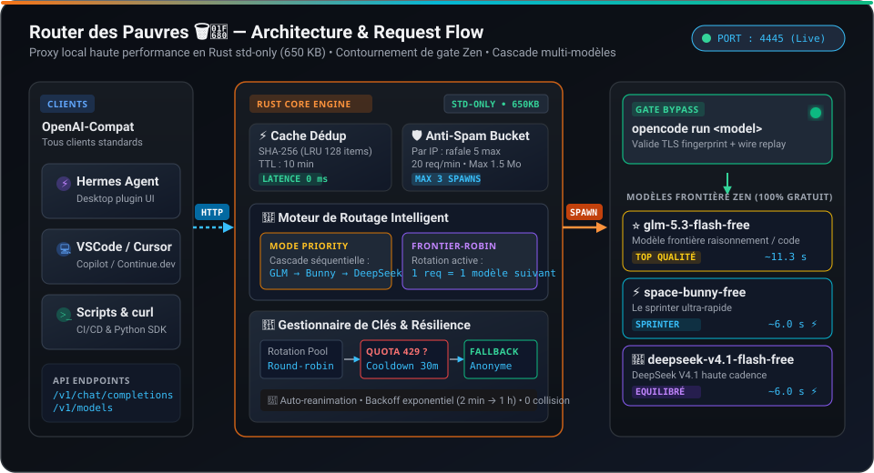
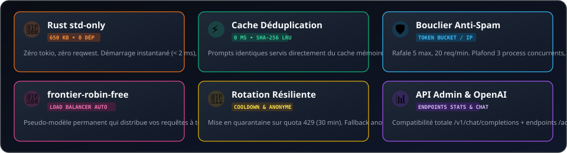
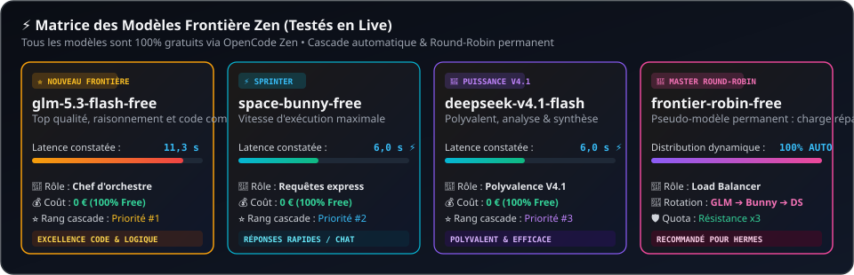
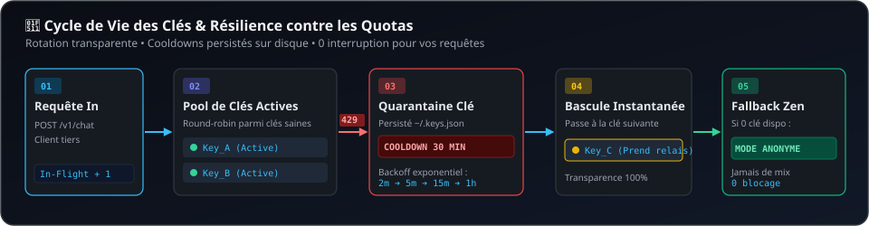
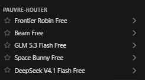

# Le Router des Pauvres 🗑️🚀

<p align="center">
  
</p>

<p align="center">
  <a href="#-fonctionnalités-clés"></a>
  <a href="#-fonctionnalités-clés"></a>
  <a href="#-modèles-frontière-gratuits--matrice-comparative"></a>
  <a href="#-endpoints-http"></a>
  <a href="#-modèles-frontière-gratuits--matrice-comparative"></a>
  <a href="#-licence"></a>
</p>

> **Le proxy local qui route vers les modèles frontière gratuits d'OpenCode Zen** — pour tous ceux qui refusent de payer des abonnements, n'ont aucun budget API et veulent lancer des dizaines d'agents.

---

## 💡 Pourquoi ce projet ?

Depuis le **14 octobre 2026**, OpenCode Zen exige l'empreinte cryptographique du client officiel OpenCode (TLS handshake spécifique + wire verification anti-MITM / anti-replay).
Impossible d'appeler l'API en direct avec un simple `curl` ou un client OpenAI standard sans se faire bloquer.

**Router des Pauvres** résout élégamment le problème :
1. Il reçoit vos requêtes sur son interface standard `POST /v1/chat/completions`.
2. Il délègue l'exécution sous le capot au binaire officiel `opencode run` qui valide le fingerprint à 100%.
3. Il restitue les flux en format `chat.completions` standard avec gestion des caches, du rate-limiting et de la redondance.

---

## 🏛️ Architecture & Flux d'Exécution

<p align="center">
  
</p>

---

## ✨ Fonctionnalités Clés

<p align="center">
  
</p>

- **Standard** : `POST /v1/chat/completions`, `GET /v1/models` — branche n'importe quel client (Hermes, scripts, curl, Continue.dev, VSCode…)
- **⭐ GLM 5.3 Flash gratuit** en tête de cascade (qualité frontière, testé en live)
- **`frontier-robin-free`** — notre pseudo-modèle **round-robin permanent** : chaque requête tourne sur les frontières (`glm` → `space-bunny` → `deepseek` → `glm` → …). La répartition de charge en un seul identifiant de modèle.
- **2 modes de routage** (switch à chaud via `/admin/mode`) :
  - `priority` (défaut) : **exhaust le meilleur modèle** avant de basculer sur le suivant
  - `roundrobin` : répartit la charge uniformément à chaque requête
- **🔑 Rotation de clés API toujours active** : le pool tourne en round-robin par défaut — clé quota-blocked = cooldown 30 min persistant, la suivante prend le relais, **fallback anonyme** si aucune clé utilisable (jamais de mix clé/anonyme, sinon `Invalid credential` chez Zen)
- **Détection d'exhaustion & Quarantaine** : classification (quota / rate-limit / model invalide / timeout) + **cooldowns à backoff exponentiel** (2 min → 1 h)
- **Anti-spam robuste** : token bucket par IP (rafale 5, 20 req/min), plafond 3 spawns opencode simultanés, body max 1,5 Mo
- **Cache de déduplication** : prompts identiques servis du cache en 0 ms (TTL 10 min, LRU 128, hash sha256 maison)
- **Administration à chaud** : `/admin/stats`, `/admin/mode`, `/admin/keys`, `/admin/reset`
- **Persistance automatique** : santé + stats (60 s) et cooldowns de clés enregistrés sur disque
- **Rust std-only** : binaire unique ~650 KB, zéro dépendance lourde (aucun tokio/reqwest)

---

## ⚡ Modèles Frontière Gratuits & Matrice Comparative

<p align="center">
  
</p>

| Modèle | Latence | Spécialité | Statut |
|---|---|---|---|
| `space-bunny-free` | **6,0 s** ⚡ | Le sprinter ultra-rapide pour questions courtes et chat | 🟢 Gratuit Zen |
| `deepseek-v4.1-flash-free` | **6,0 s** ⚡ | Modèle polyvalent DeepSeek V4.1, analyse & synthèse | 🟢 Gratuit Zen |
| ⭐ `glm-5.3-flash-free` | 11,3 s | **Frontière de pointe** — qualité supérieure pour le code et le raisonnement | 🟢 Gratuit Zen |
| 🔄 `frontier-robin-free` | *Dynamique* | **Pseudo-modèle maître** — équilibrage de charge tournant sur les 3 frontières | 🟣 Master Load-Balancer |

> **Ordre de cascade en mode priorité :**  
> `glm-5.3-flash-free` ➔ `space-bunny-free` ➔ `deepseek-v4.1-flash-free`.  
> Le modèle demandé explicitement passe toujours en premier ; `frontier-robin-free` route sur les trois en rotation continue.

---

## 🔑 Rotation de Clés & Résilience Quotas

<p align="center">
  
</p>

1. **Pool Actif** : Vos clés API tournent en round-robin pour maximiser le débit sans saturer une clé unique.
2. **Détection 429** : Dès qu'une clé retourne un quota épuisé, elle est placée en quarantaine immédiate pendant 30 min (persisté dans `~/.pauvre-router-keys.json`).
3. **Bascule Instantanée** : La clé suivante prend le relais sans que le client ne subisse d'erreur.
4. **Fallback Anonyme** : Si toutes les clés du pool sont en quarantaine, le router bascule en mode Zen Anonyme sans mélanger les états.
5. **Backoff Progressif** : En cas d'erreurs répétées (rate-limit ou timeout), les cooldowns passent de 2 min ➔ 5 min ➔ 15 min ➔ 1 h.

---

## 🔌 Endpoints HTTP

| Endpoint | Méthode | Description |
|---|---|---|
| `/health` | `GET` | État vivant, version compilée et requêtes in-flight |
| `/v1/models` | `GET` | Liste des modèles disponibles (`frontier-robin-free` + les 3 frontières) |
| `/v1/chat/completions` | `POST` | Chat standard (cascade/mode automatique) |
| `/admin/stats` | `GET` | Métriques d'usage, état de santé, statistiques anti-spam, mode actif |
| `/admin/mode` | `GET` / `POST` | Consultation et bascule à chaud du mode de routage (`priority` / `roundrobin`) |
| `/admin/keys` | `GET` | Métadonnées du pool de clés (clés masquées pour sécurité) |
| `/admin/keys/add` | `POST` | Ajoute une clé API au pool : `{"key": "sk-..."}` |
| `/admin/keys/remove` | `POST` | Retire une clé API du pool : `{"key": "sk-..."}` |
| `/admin/keys/reanimate`| `POST` | Réactive une clé ou purge tous les cooldowns : `{}` ou `{"key": "sk-..."}` |
| `/admin/reset` | `POST` | Purge intégrale du cache de déduplication et des cooldowns modèles |

---

## 🚀 Installation & Démarrage

Guide complet multi-plateformes (Windows / Linux / macOS, service auto-start, plugin Hermes) : **[SKILL.md](SKILL.md)**.  
Feuille de route et évolutions : **[TODO.md](TODO.md)**.

```bash
# Compilation du binaire optimisé (~650 KB)
cargo build --release

# Lancement
./target/release/pauvre-router.exe
```

### Variables d'Environnement

| Variable | Valeur par défaut | Description |
|---|---|---|
| `PAUVRE_OPENCODE` | Chemin auto détecté (Windows) | Chemin absolu vers le CLI `opencode` (*requis sur Linux/macOS*) |
| `PAUVRE_STATE` | `~/.pauvre-router-state.json` | Fichier de persistance des statistiques et de la santé |
| `PAUVRE_KEYS` | `~/.pauvre-router-keys.json` | Fichier de stockage sécurisé du pool de clés et cooldowns |
| `PAUVRE_MODE` | `priority` | Mode de routage par défaut au démarrage (`priority` ou `roundrobin`) |

---

## 🦹 Intégration Hermes Desktop

Ajoutez ce provider dans votre configuration Hermes (`config.yaml`) :

```yaml
custom_providers:
- name: router-des-pauvres
  base_url: http://127.0.0.1:4445/v1
  api_key: pauvre
  api_mode: chat_completions
  models:
    frontier-robin-free: {}
    glm-5.3-flash-free: {}
    space-bunny-free: {}
    deepseek-v4.1-flash-free: {}
```

> ⚠️ **Note :** La liste `models:` du `config.yaml` est statique : c'est elle qui alimente le picker de modèles d'Hermes.

Résultat dans le picker d'Hermes Desktop — le groupe **ROUTER-DES-PAUVRES** avec les 4 modèles, sélection de `space-bunny-free` (contexte XHIGH) :

<p align="center">
  
</p>

### 🖥️ Plugin Desktop Hermes

Un pane de monitoring en temps réel pour Hermes (santé, cooldowns, métriques, mode en badge) est fourni avec le projet.  
Consultez le **[`SKILL.md`](SKILL.md) §3** pour la configuration pas-à-pas.

---

## 📦 Releases

Les binaires Windows, Linux et macOS sont construits et packagés automatiquement par GitHub Actions à chaque tag :  
Consultez la page **[Releases](../../releases)** pour télécharger les binaires précompilés.

## 🧪 Tests

**73 tests** (49 unitaires + 6 backend stub + 18 E2E), tous verts en `cargo test` comme en `cargo test --release` :

- **E2E** (`tests/e2e.rs`) : de vrais serveurs démarrent sur des ports éphémères (mêmes workers que la prod) et parlent TCP pour de vrai — un stub `opencode` (`src/bin/stub-opencode.rs`, piloté par env `STUB_FAIL`) remplace le CLI réel. Couverture : cascade de fallback, cooldowns, 429 tous-cooldowns, anti-spam token bucket, SSE streaming, cache, rotation de clés prouvée côté spawn, timeout backend, keep-alive, 413, persistance de l'état sur reboot, 12 requêtes concurrentes.

---

## 📜 Licence

Projet distribué sous licence **MIT** — mais le nom officiel reste « **le router des pauvres** ». 🗑️🚀
